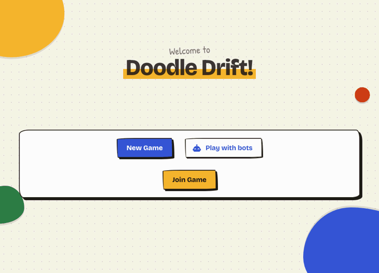

# Doodle Drift

A drawing-telephone party game where nobody waits for the slowest drawer.

Everyone writes a word in their own notebook and passes it on. The next player
draws it, the next guesses the drawing, the next draws the guess, and so on
round the table, until each notebook comes home as a story that drifted
somewhere unexpected.



**Play it:** [doodle-drift.fly.dev](https://doodle-drift.fly.dev). On your
own, press **Play with bots**; with friends, press **New Game** and send them
the code.

## What makes it different

- **Notebooks, not rounds.** Online versions usually move everyone in
  lockstep: nobody starts the next round until the slowest player finishes.
  Here each notebook moves on the moment its player is done. Notebooks pile
  up in front of slow players and can be taken in any order, and the waiting
  screen shows the table: who's holding what, who's working, who's away.
- **Play with bots.** One person can play a whole game. The bots draw simple
  doodles and guess, close but not always right, which is where the drift
  comes from.
- **Built to be robust, not just to work.** The turn rotation lives in SQL
  views, every write is checked against it inside a transaction, and races
  between players (two submits at once, a drop mid-turn, a join as the game
  starts) are tested by running them against each other over and over.
- **One binary, home or internet.** A game is reachable only with its code,
  in every mode. It serves the whole game on a home network with no setup, or
  on the internet in public mode: rate limits, games deleted 48 hours after
  they end or once they sit idle (the public mode section has the details),
  and a strict Content-Security-Policy.

## How it's built

- **Server:** Go on [PocketBase](https://pocketbase.io) (SQLite, REST and
  realtime). The game's rules are record hooks and write guards
  (`internal/game`); whose turn it is comes from SQL views over the turns
  (`internal/migrations`). Host controls, End Game, Play again, bots and
  expiry are all server-side. The server checks a turn's timeout, but each
  player's page starts it when their timer runs out.
- **Web app:** Vue 3 and Vuetify, built with Vite and embedded in the binary.
  An MS-Paint-style drawing tool, live updates over server-sent events, and
  phone photos (HEIC) converted in the browser.
- **Tests:** a Go harness that plays the real API (race soaks, model-based
  random games, migrations run forward and back, an access test for each of
  the game's routes), a Playwright suite that plays whole games across browser
  windows, and CI that also scans dependencies for known vulnerabilities and
  builds the Docker image.
- **Hosting:** a small Fly.io machine that stops when nobody's playing
  ([DEPLOY.md](DEPLOY.md)).

## How this was built

I built the first version by hand in September 2025, to play with friends:
the Vue app, the PocketBase backend and the basic rotation.

From July 2026 I worked on it with Claude, an AI coding assistant. I chose
what to build and how it should behave, ran the playtests where the bugs
turned up, reviewed the changes, and decided what shipped; Claude wrote most
of the code and tests from then on, including the work to host it publicly
(access by game code, limits, expiry, the bots, and this README's GIF). The
commit history and the pull requests show the work as it happened.

## Playing it

### Starting a game

**New Game** makes a game and shows its five-letter code; friends join with
**Join Game** and the code. The host sets the seating order and presses
**Begin**. **Play with bots** does the same with three bots already seated.

### Playing with bots

Bots are players the server plays (`internal/game/bots.go`): each takes a
few seconds over a turn, opens with a word, draws one of a dozen doodles
(`doodles.go`; one that matches the word if it can, any if not), and
guesses. A bot's guess at another bot's doodle is close but not always the
same; a person's drawing gets a wild guess. That's the drift.

Bots only play while a person in the game has been around in the last ten
minutes, so a game everyone has left goes quiet and expires like any other.
They come along to Play again, and count as players everywhere else.

### Drawing

The drawing turn works like MS Paint: tools down the left, colors along the
bottom, and **Undo**, **Redo**, **Clear** and **Submit** across the top. Clear
can be undone. Or upload a photo instead.

- **Colors:** tap one to draw with it. To set the background instead, tap the
  back color square first (or right-click a color). **+** opens a full color
  picker, and custom colors stay in the recent slots on that device.
- **Fill bucket:** fills the area you tap, up to the lines around it.
- **Behind lines:** while it's on, whatever you draw or fill goes under your
  outlines, and the eraser takes off only that color.
- Also an eyedropper, a spray can, lines, rectangles, ovals and triangles
  (outlined or filled), and five sizes. Drawings are saved at 1200 × 800.
- Keys: **B**, **E**, **G**, **I** and **S** for the brush, eraser, fill,
  eyedropper and spray; **L**, **R**, **O** and **T** for shapes; **H** for
  Behind lines; **[** **]** or **1**–**5** for size; **Shift** snaps a shape;
  **Ctrl+Z** undoes, and **Ctrl+Y** or **Ctrl+Shift+Z** redoes.

### Rounds

The **New Game** dialog sets how many rounds to play: how many times each story
goes around the group (one by default). **Infinite** keeps the stories going
around until the host uses **End Game**. (Timed rounds, below, are about how
long each turn lasts.)

### Timed rounds

When a player's timer runs out:

- **They'd started:** whatever they typed or drew is submitted as their turn.
- **They hadn't:** the turn is skipped like a host skip. The previous word or
  drawing passes on unchanged; an empty opening word gets a random one.

During the game these look like any other turn to the next player. The review
marks them: partial work gets a "⏱ Ran out of time" banner, and an empty turn
gets a "⏱ *name* ran out of time" slide.

### Host controls

During a game, the host has a **Manage players** button (the person-and-gear
icon in the top bar) on the turn and review screens. It lists every player and
how many stories are waiting on them.

- **Skip** writes the turns that player owes right now, passing the previous
  word or drawing on unchanged, so the next player isn't held up. The player
  keeps playing after that. If they hadn't written their opening word yet, a
  random one is picked.
- **Drop** does the same for the rest of the game. If they never wrote an
  opening word, their story is removed. If a story is somehow still waiting on
  a dropped player, the dialog offers **Skip** for them again.
- **View results** opens the review mid-game, with every story so far. Anyone
  can open it from the game's link (`/<code>/review`), and a player who still
  has turns to play gets a **Back to game** button there.
- **End Game** ends it for everyone. Anyone in the middle of a turn gets 10
  seconds to finish it; when time's up, whatever they have is submitted (marked
  "⏱ Ran out of time" in the review), and everyone goes to the review.

Turns the host skipped are hidden on the review page. A skipped opening word is
the exception: it's shown with a "Skipped by the host" banner.

There are no accounts, so these controls (like the rest of the game) trust the
people in the game: they stop mistakes, not a determined cheat.

### Saving the stories

On the review page, the last card of each story has **Download this story**,
which saves it as one image: each turn in order, with who wrote or drew it.
**Download all stories**, at the top of the player list, saves a zip
of every story's image. Any player can download, not just the host.

### Playing again

When everyone's done, the host's review page has **Start new game**: the same
players (minus anyone dropped) in the same seats, with the same settings or
new ones. Everybody on the review goes straight to their first turn. Anyone
who'd wandered off finds a **Join the new game** button on the old game's
review page.

## Running it yourself

### On your home network

This builds everything into a single binary. It serves the API and the web app
from the same origin, so every device only needs one URL. You need Go and Node.

```sh
make run      # npm install, build the web app and the server, serve on 0.0.0.0:8090
```

`make run HTTP=0.0.0.0:9000` picks another port, and `make build` just builds
`bin/doodledrift`. To run that yourself, give it the data directory:
`./bin/doodledrift serve --dir pb_data --http 0.0.0.0:8090`. The games are
kept in `pb_data`; without `--dir`, a built server keeps them next to itself,
in `bin/pb_data`.

Find your machine's LAN IP (macOS: `ipconfig getifaddr en0`). Then everyone opens
`http://<that-ip>:8090` on their own device, all on the same Wi-Fi. If macOS asks
whether to allow incoming connections, allow them.

The web app is embedded at build time, so rebuild after any change to it.
`make help` lists every target.

### On the internet: public mode

On a home network the game trusts the people in the room. A server on the
internet can't, so it runs in public mode, set from the environment:

- `PUBLIC_MODE=1` (or `true`, `yes`, `on`) turns it on; `0`, `false`, `no`,
  `off` or unset leaves it off. Any other value (a typo, say) stops the server
  rather than starting it in home mode. The Docker image sets `PUBLIC_MODE=1`;
  run it with `-e PUBLIC_MODE=0` for home mode.
- `ADMIN_EMAIL` and `ADMIN_PASSWORD` (at least 20 characters) are the only
  superuser. The server won't start without them; it creates or updates that
  superuser on every start and removes any other. It prints no setup link.
- `ADMIN_DASHBOARD=1` serves the dashboard (`/_/`) and lets the superuser sign
  in. Without it, both answer 404. Turn it on to read the logs, then off again.
- `TRUSTED_PROXY_HEADER` names the header the proxy in front of the server puts
  each visitor's address in (`Fly-Client-IP` on Fly.io). Set it only behind
  such a proxy: anywhere else a visitor could write their own.
- Limits, per visitor's address: requests are rate limited (generously, as a
  whole party can share one home router), and an address that tries many
  different game codes that don't exist is turned away for ten minutes. An
  IPv6 address counts by its /64: always for the wrong codes, and behind
  `TRUSTED_PROXY_HEADER` for the rate limits too, where the logs then show the
  /64 rather than the full address.
- `MAX_PLAYERS` (default 30) caps the players in a game, and `MAX_GAMES`
  (default 1000) the games on the server.
- The client log only takes reports about a game that exists.
- Games are deleted, drawings and all, 48 hours after they end (every story
  has gone all the way round, or the host's End Game ran out), after 7 days
  with nothing happening in them, or, for a game nobody started, after an hour
  with nothing happening (a host who still has the page open counts as
  something happening). The review page says so. Logs, which hold
  players' names and addresses, are kept for 2 days.
- Security headers: HSTS, a Content-Security-Policy that loads only what the
  site ships, no framing by other sites, and a referrer that stays on the
  site. No other site's page may call the API (no CORS).

Everywhere, public or not, a name is at most 24 characters and a word or guess
at most 200.

Without `PUBLIC_MODE` (`make run`, say), none of this applies but those text
limits.
[DEPLOY.md](DEPLOY.md) puts the game on Fly.io in public mode, and
[docs/hosting-plan.md](docs/hosting-plan.md) is the plan the work followed.

### Who can see a game

A game's code is the key to it. The server shows a game, its players, stories
and drawings only to requests that carry the code (the web app sends it in an
`X-Game-Code` header), and the same goes for live updates. Without it, a game
might as well not exist. Changing or deleting a game, a story or a turn is the
server's alone.

## For developers

### Layout

- `cmd/doodledrift`: the server's `main`. It puts the pieces below together.
- `internal/game`: the game itself: the record hooks and write guards, the
  host controls, End Game and Play again, the API routes, public mode, bots,
  and the Go tests.
- `internal/migrations`: the database schema and the views the turn rotation
  runs on.
- `web`: the Vue app; `web/embed.go` embeds its build (`web/dist`) in the
  binary.
- `sim`: a Node soak test that plays whole games against a running server.
- `tools/readmegif`: turns the README GIF's recording into a GIF.

### Development

Run each of these in its own terminal:

```sh
make dev-server     # backend on http://127.0.0.1:8090
make dev-web        # Vite dev server on http://localhost:3000, with live reload
```

In dev, the frontend points at `http://127.0.0.1:8090/` unless you set
`VITE_POCKETBASE_URL`.

### Tests

- Browser E2E (Playwright): `make e2e`. See `web/tests/e2e/README.md`. On NixOS,
  use `web/run-e2e.sh` instead.
- Go: `make test` (`go test ./...`) tests the server against a throwaway PocketBase built
  from the migrations, through the real routes and guards: write races (two
  requests landing together), the refusal codes the client acts on, the
  rotation views, random whole games, migrations, skips and timeouts, access
  by game code, public mode's limits and expiry, bots, the client log and
  static serving. `-short` skips the concurrent soaks and plays fewer random
  games; `MODEL_SEED=<n>` replays one random game. `make test-race` runs them
  under the race detector, as CI does.
- `make lint` runs gofmt, `go vet` and ESLint.
- Rotation soak test: see `sim/README.md`.
- A deployed server: `make -C web hosted URL=https://...` (see DEPLOY.md).
- The GIF at the top: `make readme-gif` plays a four-player game, each
  player in their own browser (`web/tests/e2e/readme-gif.spec.js`, skipped
  in ordinary runs). It keeps a screenshot of one player's screen at each
  moment worth showing, and turns them into `docs/demo.gif`
  (`tools/readmegif`). Re-make it after changing the UI.

CI (`.github/workflows/ci.yml`) runs gofmt, `go vet`, ESLint, the Go tests, the
E2E suite and a build of the Docker image on every PR and every push to master;
`security.yml` scans the Go and npm dependencies on every PR and weekly. The
checks are advisory: none is required, so a red check flags a problem without
blocking the merge.

### Tracing a game

Every browser sends its game events to the server (`/api/client-log`), and the
server records each turn as it's saved. All of it lands in the PocketBase
dashboard under **Logs** (`http://<ip>:8090/_/#/logs`). To sign in there, make
yourself a superuser: follow the setup link the server prints the first time it
starts, or run `./bin/doodledrift superuser upsert you@example.com <password>`
(with `--dir` if the games aren't next to the binary). Useful filters:

- `data.game = "abcde"`: everything from every device in one game, by game code
- `data.user = "firefox"` or `data.browser = "safari"`: one player or one browser
- `level >= 4`: warnings and errors only

Most client entries (`client: ...`) carry a per-tab `session`, a `seq` number and
the device's own clock, so you can put each device's timeline back in order.
Look for these first:

- `turn: wrong type for position`: a drawing slot got text, or a guess slot got
  a drawing.
- `turn: out of rotation`: a turn was written to the wrong story. (A second
  write to the same place in a story is refused outright by a unique index.)
- `client: turn.submit.typeMismatch`, `client: progress.staleStory`: the client
  caught itself in an inconsistent state.
- `host: action` / `host: turn skipped`: the host skipped or dropped a player
  from the Manage players dialog, and which turns the server wrote for them.

## License

MIT (see [LICENSE](LICENSE)).
